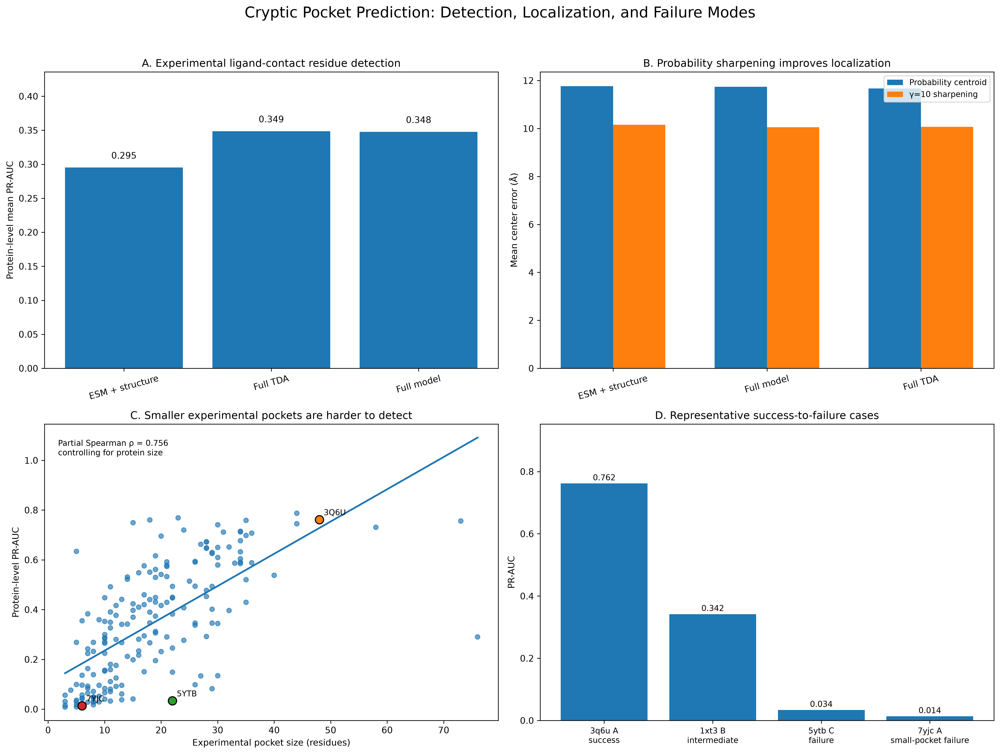
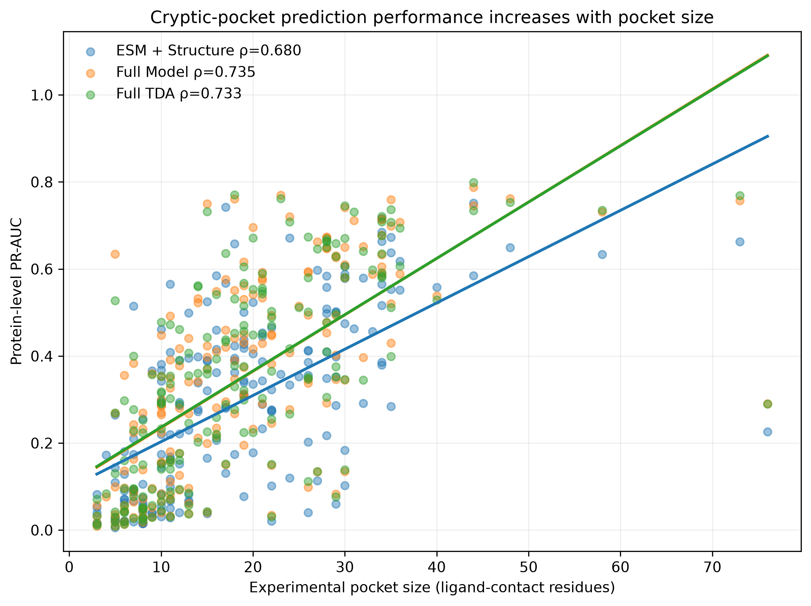
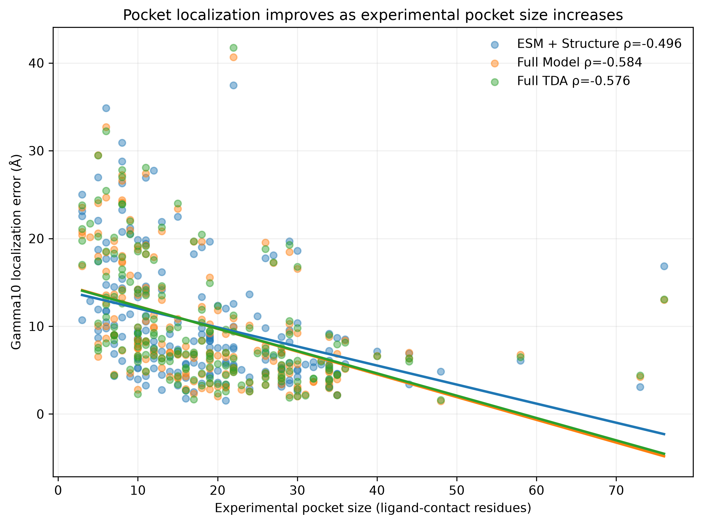
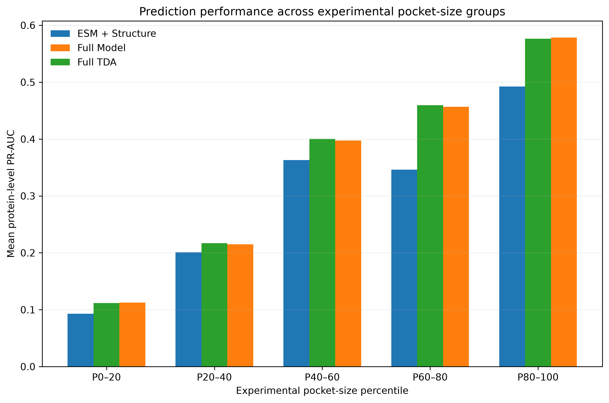
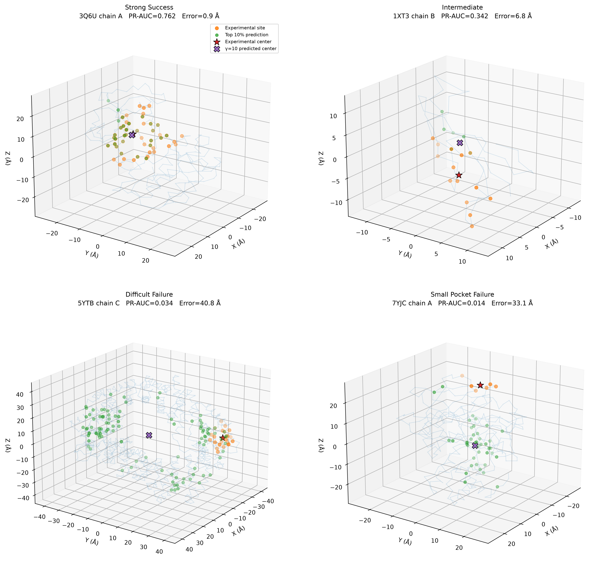
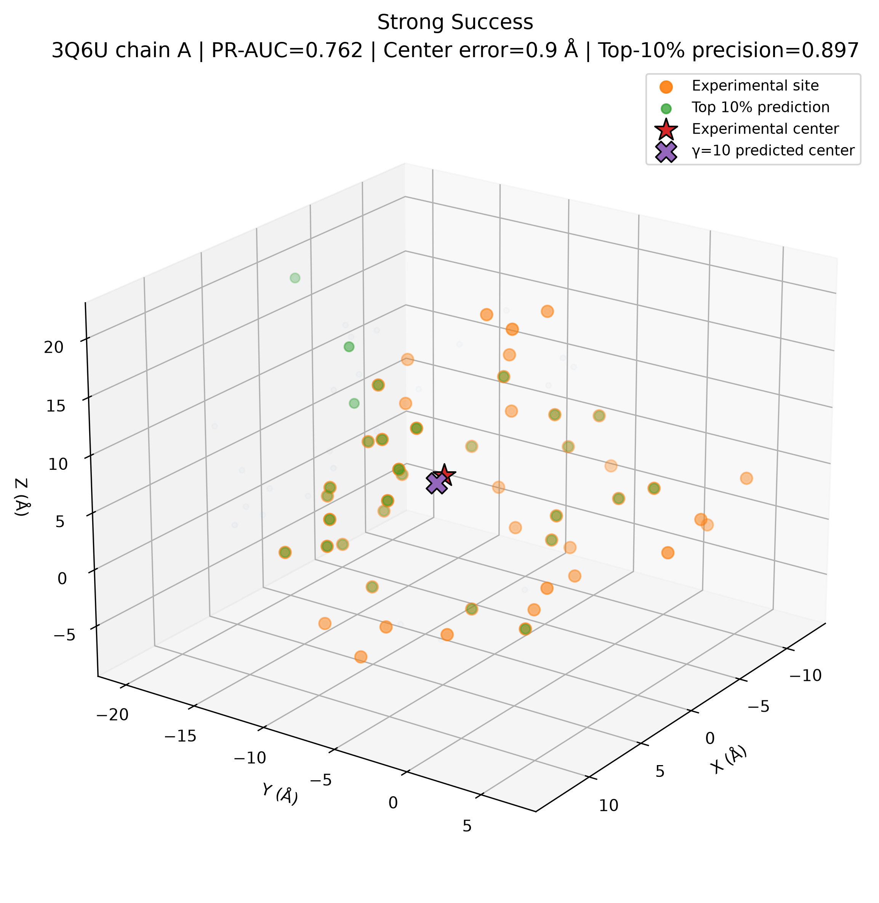
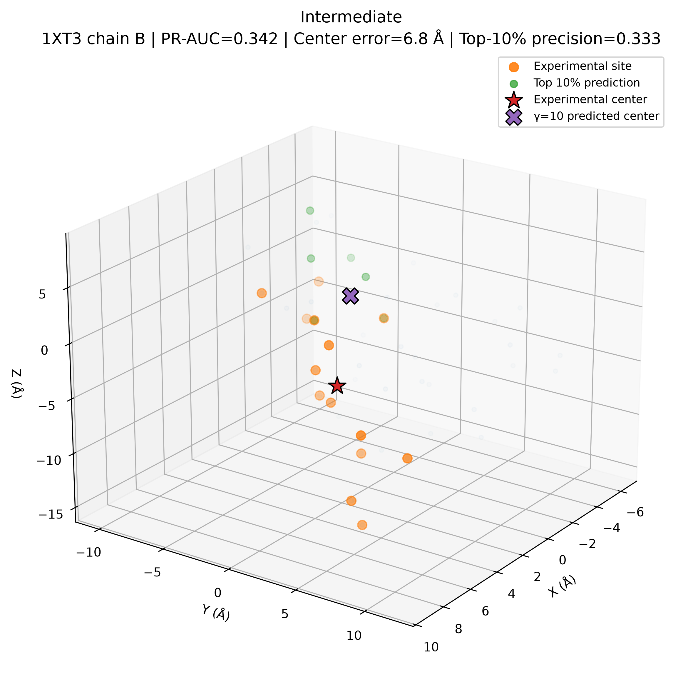
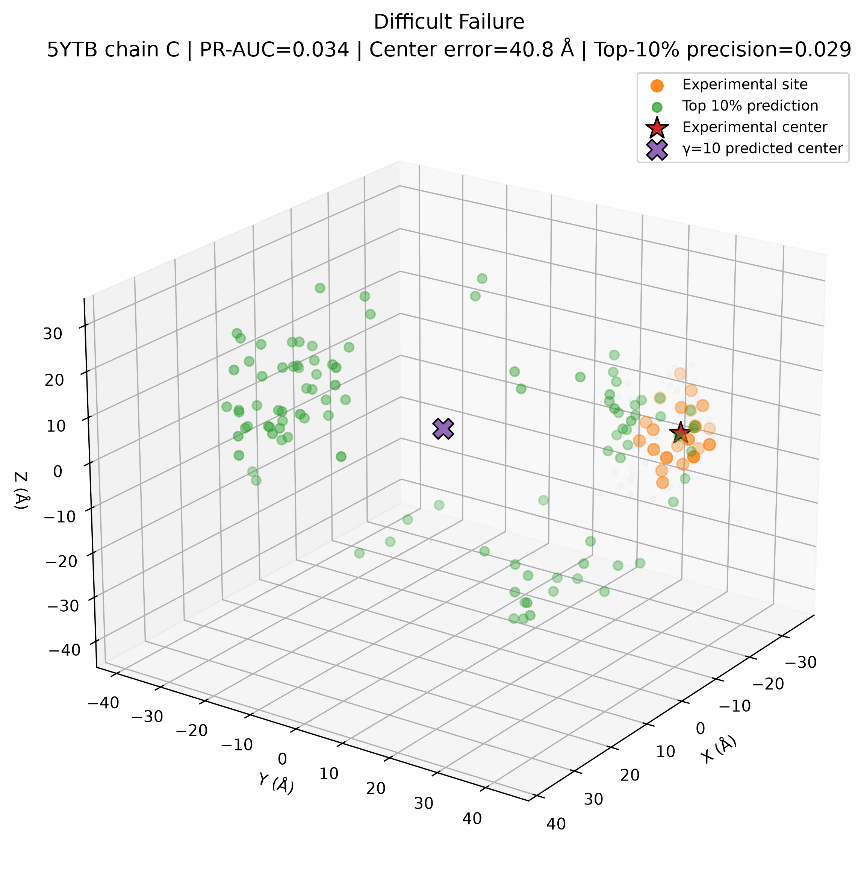
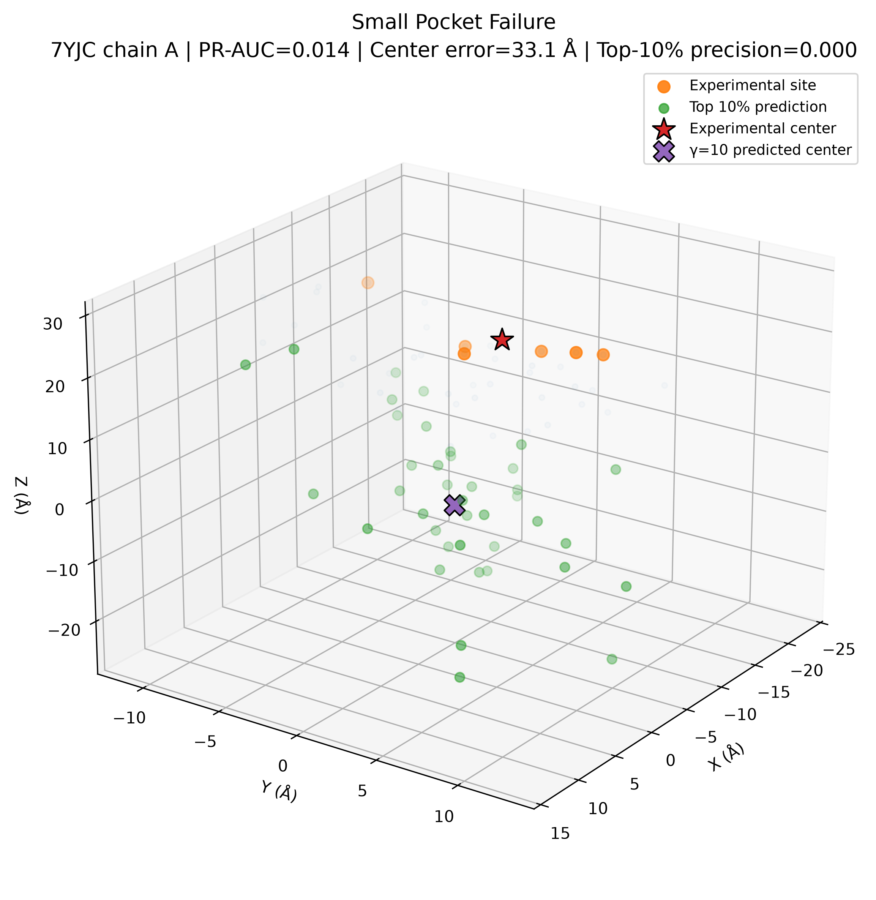

# Topological Representation Learning for Cryptic Protein Pocket Prediction and Spatial Localization

## Abstract

Cryptic protein binding pockets are ligand-binding regions that are not readily apparent in an apo protein structure, making their computational identification challenging. We developed a residue-level graph-learning framework that combines protein language model embeddings, structural descriptors, topological data analysis (TDA), and anisotropic network model mean-square fluctuations (ANM-MSF) to predict experimentally defined cryptic binding-site residues. The model was evaluated on a predefined 185-protein experimental holdout using ligand-contact residues derived from experimentally characterized protein-ligand structures.

Adding TDA to ESM-derived and conventional structural features increased mean protein-level PR-AUC from 0.2952 to 0.3485 and median ROC-AUC from 0.8291 to 0.8595. Adding ANM-MSF did not provide a meaningful additional improvement, with the full model achieving a mean PR-AUC of 0.3476. The predicted residue-probability field also contained spatial information that could be extracted without retraining the model. Probability sharpening reduced mean center error from 11.768 Å to 10.159 Å for ESM + structure and from 11.736 Å to 10.053 Å for the full model. High-probability residues were also strongly enriched around experimentally defined pocket centers.

Performance depended strongly on experimental pocket size. For the full model, pocket size showed a partial Spearman correlation of 0.756 with PR-AUC after controlling for protein size (p = 1.7 × 10^-35), while the partial correlation with localization error was -0.603 (p = 1.1 × 10^-19). These associations identify small experimentally defined binding sites as an important observed source of difficulty on this holdout.

Overall, the results show that adding TDA-derived structural features improves cryptic-pocket residue prediction on the experimental holdout and that the learned residue-probability field contains spatial information that can be used for pocket localization. The study also provides a quantitative characterization of pocket-size-dependent performance and identifies small binding sites as an important direction for future model development.

## Research Question

Can topological structural representations improve cryptic-pocket residue prediction from apo protein structures, and can the resulting residue probability field be used to localize experimentally defined binding sites?

## Hypotheses

### H1: TDA

Adding TDA-derived structural features to ESM and conventional structural features will improve cryptic-pocket residue prediction on a predefined experimental holdout.

### H2: ANM-MSF

Adding ANM-MSF features to the TDA-enhanced representation will provide additional predictive information related to cryptic binding sites.

### H3: Spatial information

The residue-level probability field will contain spatial information that can be used to localize experimentally defined binding sites.

### H4: Pocket size

Smaller experimentally defined binding sites will be more difficult for the model to identify and localize.

## Independent Variables

1. Model feature configuration:
   - ESM + structure
   - ESM + structure + TDA
   - ESM + structure + TDA + ANM-MSF

2. Probability localization method:
   - unsharpened probability centroid
   - probability sharpening
   - top-k residue centroid methods

3. Experimental pocket size and pocket fraction.

## Dependent Variables

1. Protein-level PR-AUC
2. ROC-AUC
3. Top-k enrichment
4. Top-k precision
5. Top-k recall
6. Pocket-center localization error
7. DCC4
8. DCC6
9. DCC8
10. DCC10

## Key Contributions

1. A graph-based cryptic-pocket prediction framework combining protein language model, structural, and topological representations.

2. Direct evaluation against experimentally defined ligand-contact residues on a 185-protein holdout.

3. Evidence that TDA provides a measurable improvement over ESM + structure for experimental-site prediction.

4. Demonstration that the residue-probability field contains spatial information that can be extracted through non-retrained probability sharpening.

5. Quantitative characterization of pocket-size-dependent prediction difficulty after controlling for protein size.

6. Identification of small experimentally defined pockets as an important failure regime for future model development.

## Keywords

cryptic pockets; protein binding sites; protein language models; topological data analysis; graph neural networks; computational biology; protein structure; ligand binding; machine learning; structural bioinformatics
# Introduction

## Background

Proteins are dynamic three-dimensional molecules whose biological functions depend on interactions with other molecules. Many therapeutically relevant interactions occur at binding pockets that are not readily apparent in a single experimentally determined protein structure. These cryptic pockets can emerge when local conformational changes expose or reshape regions capable of binding a ligand.

Identifying cryptic binding pockets from apo structures is therefore a challenging computational problem. Conventional pocket-detection approaches generally rely on geometric or physicochemical properties of the observed structure. However, cryptic pockets may not exhibit the geometric characteristics of conventional binding sites in the apo state.

Recent advances in protein language models provide another source of information. Protein language models can encode sequence-derived representations that capture evolutionary and structural information without requiring explicit evolutionary alignment during inference. ESM-2 is a representative protein language model that produces sequence-derived representations useful for protein structure-related prediction tasks [2]. Combining such representations with structural features provides a potential framework for detecting cryptic binding regions.

At the same time, protein structure contains information that is inherently geometric and topological. Topological data analysis (TDA) provides a mathematical framework for representing structural relationships across multiple spatial scales, including persistent-homology-based representations of protein structure [8]. Such representations may capture characteristics of protein regions that are difficult to express using individual residue-level structural descriptors.

## Research gap

Existing computational approaches provide useful baselines for pocket detection. Structure-based methods such as Fpocket and P2Rank identify ligand-binding cavities from protein structure, while conservation- and structure-based approaches such as ConCavity incorporate additional sequence information [5–7]. More recent methods have addressed cryptic-pocket prediction directly; PocketMiner uses a graph neural network to predict residues associated with cryptic-pocket formation from single protein structures [4]. However, cryptic-pocket prediction remains challenging because the target site may be poorly defined in the apo structure. In addition, successful residue identification does not necessarily imply successful three-dimensional localization of the pocket.

A model may assign high probability to experimentally relevant residues while producing a spatial prediction that is poorly concentrated. Conversely, a spatially concentrated prediction may not correspond to the experimentally observed binding site. Evaluating both residue-level identification and spatial localization therefore provides a more complete assessment of cryptic-pocket prediction.

A further challenge is determining which structural representations provide useful information beyond protein-language-model embeddings. In particular, the contribution of topological structure and dynamic information can be evaluated through controlled feature comparisons.

## Research question

This study asks:

> Can topological structural representations improve cryptic-pocket residue prediction from apo protein structures, and can the resulting residue probability field be used to localize experimentally defined binding sites?

We additionally investigate whether ANM-MSF dynamic features provide incremental predictive information and which characteristics of experimentally defined pockets are associated with prediction difficulty.

## Hypotheses

We hypothesized that:

1. Adding TDA-derived structural information to ESM and conventional structural features would improve cryptic-pocket residue prediction.
2. Adding ANM-MSF features would provide additional information related to protein dynamics.
3. The residue-probability field would contain spatial information that could be used to localize the predicted pocket.
4. Smaller experimentally defined binding sites would be more difficult to identify and localize.

# Methods

## Dataset

The study used the CryptoBench benchmark [1], consisting of 942 protein-chain graphs. The original benchmark contains predefined training, validation, and test partitions. Model development was performed using the available training and validation data, while the final evaluation described here used the predefined 185-protein experimental holdout.

Each protein-chain graph contains residue-level features, graph connectivity, three-dimensional coordinates, and binary residue labels. The feature representation contains 542 dimensions per residue, including conventional structural descriptors, ESM2-35M sequence embeddings, ANM-MSF information, and TDA/burial features.

The experimental holdout was reserved for final evaluation and was not used to retrain the prediction model.

## Experimental binding-site labels

For final validation, residue labels were derived from experimentally characterized ligand-binding structures associated with the CryptoBench proteins.

An experimental binding-site residue was defined using the protein residues whose heavy atoms were within the predefined contact cutoff of the experimentally associated ligand. Water and unrelated heteroatoms were excluded. The resulting experimentally defined ligand-contact residues were mapped onto the corresponding apo protein graph.

These labels were used only for final evaluation and localization analysis.

## Model configurations

Three feature configurations were evaluated:

### ESM + structure

The baseline model used ESM2-35M sequence embeddings together with conventional structural features.

### Full TDA

The baseline representation was augmented with TDA and burial-derived structural features.

### Full model

The Full model included the TDA representation and ANM-MSF features in addition to the baseline features. ANM-MSF features were derived from anisotropic network model representations of protein fluctuation dynamics [3].

This design allowed the contribution of TDA to be evaluated relative to the baseline and the incremental contribution of ANM-MSF to be evaluated relative to TDA.

## Graph representation

Each protein was represented as a residue-level graph.

For each residue node i, the model received a feature vector x_i and three-dimensional coordinate p_i. Edges represented structural relationships between residues and included edge attributes describing the corresponding pairwise relationship.

The model produced a probability p_i for each residue representing its predicted likelihood of belonging to the cryptic-pocket region.

## Residue-level evaluation

Performance was evaluated using precision-recall area under the curve (PR-AUC) and receiver operating characteristic area under the curve (ROC-AUC).

PR-AUC was emphasized because the positive class represents a relatively small fraction of protein residues. Additional evaluations measured enrichment, precision, and recall among the highest-probability predicted residues.

Metrics were calculated both globally across residues and at the protein level. Protein-level results were obtained by calculating metrics independently for each protein and then summarizing across the 185-protein holdout.

## Statistical comparison

For paired model comparisons, each protein contributed one observation per model configuration after collapsing across the eight evaluation seeds.

Paired sign-flip permutation tests with 10,000 permutations were used to evaluate differences between model configurations. Both Benjamini-Hochberg false-discovery-rate correction and Bonferroni correction were applied to account for multiple comparisons.

All statistical tests were performed on the predefined experimental holdout rather than on training or model-selection data.

## Three-dimensional localization

The predicted residue probabilities were converted into a three-dimensional pocket-center estimate using the residue coordinates.

The initial probability centroid was calculated as:

c = sum_i p_i r_i / sum_i p_i

where p_i is the predicted residue probability and r_i is the three-dimensional coordinate of residue i.

Because the probability field was sparse, a probability-sharpening transformation was also evaluated:

w_i = p_i^gamma / sum_j p_j^gamma

A common gamma value of 10 was selected from the evaluated set of exponents and then applied to all three model configurations.

The sharpened center was calculated as:

c_gamma = sum_i w_i r_i

No model retraining was performed for this localization procedure.

Localization was evaluated using Euclidean center error and distance-based contact metrics, including DCC4, DCC6, DCC8, and DCC10. These represent the fraction of predictions whose estimated pocket center lies within 4, 6, 8, or 10 Å of the experimental pocket center.

## Spatial enrichment

To determine whether high-probability residues were spatially concentrated around the experimental pocket, predicted residues were ranked by probability.

For several top-ranked fractions, including the top 1%, 5%, 10%, and 20%, the fraction of residues located within specified distances of the experimentally defined pocket center was compared with the corresponding protein-wide background fraction.

Enrichment was calculated as:

enrichment = observed fraction / background fraction.

This analysis evaluates whether the residue-probability field contains spatial information independently of the localization aggregation method.

## Pocket-size analysis

The number of experimentally defined ligand-contact residues was used as the experimental pocket-size measure. Pocket fraction was calculated as the number of experimental residues divided by the total number of residues in the protein.

Spearman rank correlations were used to evaluate associations between pocket size, prediction performance, and localization error.

Because larger proteins may contain more residues and potentially larger binding sites, partial Spearman correlations were additionally calculated while controlling for overall protein size.

These analyses were observational and were used to characterize performance differences rather than establish causal relationships.

## TDA gain analysis

For each protein, the improvement associated with TDA was calculated as the difference between Full TDA and ESM + structure performance.

The relationship between this gain and experimental pocket size, experimental pocket fraction, and protein size was then evaluated using Spearman correlation.

This analysis was performed after model evaluation and was not used to tune the model.

## Case-study analysis

Four proteins were selected to illustrate qualitatively different performance regimes:

- 3q6u chain A: strong success
- 1xt3 chain B: intermediate performance
- 5ytb chain C: difficult failure
- 7yjc chain A: small-pocket failure

For each case, the experimentally defined binding site, predicted high-probability residues, experimental center, and probability-sharpened predicted center were visualized in three dimensions.

These examples were selected to illustrate patterns observed in the full holdout and were not treated as an independent validation set.
# Results

## Experimental validation of cryptic-pocket residue prediction

We evaluated the three model configurations on the predefined 185-protein experimental holdout using experimentally defined ligand-contact residues as the reference labels. The ESM + structure baseline achieved a mean protein-level PR-AUC of 0.2952 and a median ROC-AUC of 0.8291. Incorporating topological data analysis (TDA) increased the mean protein-level PR-AUC to 0.3485 and the median ROC-AUC to 0.8595. The full model, which additionally incorporated ANM-MSF features, achieved a mean protein-level PR-AUC of 0.3476 and a median ROC-AUC of 0.8553.

The improvement from TDA was consistent across multiple evaluation criteria. Relative to ESM + structure, Full TDA significantly improved protein-level PR-AUC, ROC-AUC, and top-k experimental-site enrichment, precision, and recall across the evaluated fractions. Paired sign-flip permutation tests with 10,000 permutations showed significance after both Benjamini-Hochberg and Bonferroni correction for all 17 evaluated metrics (permutation p < 10^-4). In contrast, adding ANM-MSF to the TDA model did not produce a meaningful additional improvement in experimental-site PR-AUC or top-k enrichment. Thus, the observed incremental improvement was attributable to adding TDA, whereas ANM-MSF did not provide a measurable additional benefit under the current model and evaluation design.

At the global residue level, the same pattern was observed. PR-AUC increased from 0.2581 for ESM + structure to 0.3115 for Full TDA and 0.3076 for the Full model. These results provide direct experimental-site validation that the predicted residue probabilities identify residues associated with experimentally observed ligand-binding regions.

## Probability-based localization

We next investigated whether the residue-level probability field could be used to localize the predicted cryptic pocket in three-dimensional space. A learned coordinate-prediction head produced substantially weaker localization than several simple probability-based aggregation methods. We therefore tested probability sharpening, in which each residue probability was raised to the tenth power before normalization:

w_i = p_i^10 / sum_j p_j^10.

This operation concentrates the localization estimate around the highest-confidence residues without retraining the model.

For ESM + structure, the mean center error decreased from 11.768 Å using the unsharpened probability centroid to 10.159 Å after probability sharpening. For the Full model, center error decreased from 11.736 Å to 10.053 Å, while Full TDA decreased from 11.671 Å to 10.066 Å. The improvement was also observed across distance-based localization metrics, including the fraction of predictions within 4, 6, 8, and 10 Å of the experimentally defined pocket center.

Paired statistical testing showed that probability sharpening substantially improved localization over the unsharpened probability centroid and highly sparse top-1% aggregation. However, sharpened probabilities were generally comparable to selecting the top 10% of residues. These results indicate that the residue classifier contains spatial information that can be extracted without introducing an additional trained localization model.

The experimental-positive residue centroid produced a substantially smaller localization error, but this quantity uses the experimentally defined residues themselves and therefore serves only as an oracle/reference measurement rather than a deployable prediction method.

## Spatial enrichment of predicted residues

The predicted probability fields were further evaluated for spatial enrichment around experimentally defined pocket centers. Across the 185-protein holdout, high-probability residues were substantially enriched near the experimentally defined centers relative to the corresponding protein-wide background.

For the Full model, the strongest enrichment occurred among the top 1% of predicted residues: the enrichment was approximately 6.4-fold within 4 Å of the experimental center and approximately 10.7-fold within 6 Å. Full TDA produced comparable enrichment, including approximately 10.5-fold enrichment within 6 Å. ESM + structure showed the same qualitative pattern but with lower enrichment.

Protein-level paired permutation tests confirmed that these enrichments were highly significant across the evaluated probability fractions and distance thresholds. Direct comparisons between Full TDA and ESM + structure showed significant improvements across many localization-enrichment conditions, whereas Full TDA and Full model were not meaningfully different in these localization measures.

Together, these analyses show that the predicted residue probabilities are not merely enriched for experimental binding-site labels; they are also spatially concentrated around the experimentally defined pocket region.

## Dependence on experimental pocket size

We analyzed performance as a function of experimentally defined pocket size to identify systematic failure modes. Experimental pocket size was strongly associated with prediction performance across all three model configurations.

For the Full model, experimental pocket size had a Spearman correlation of 0.762 with protein-level PR-AUC. Pocket size was also negatively associated with localization error (rho = -0.584), indicating that larger experimentally defined binding sites were generally easier to identify and localize. These relationships remained strong after controlling for overall protein size. The partial Spearman correlation between pocket size and Full-model PR-AUC was 0.756 (p = 1.7 × 10^-35), while the partial correlation with center error was -0.603 (p = 1.1 × 10^-19).

The same trend was observed for Full TDA and ESM + structure. Across pocket-size quintiles, Full-model mean PR-AUC increased from 0.0867 in the smallest pocket-size group to 0.5589 in the largest group, while mean center error decreased from 16.82 Å to 6.00 Å.

The incremental benefit of TDA also varied with pocket size. TDA PR-AUC gain relative to ESM + structure was positively associated with experimental pocket size (rho = 0.366, p = 2.9 × 10^-7) and experimental pocket fraction (rho = 0.343, p = 1.7 × 10^-6). The gain was not significantly associated with overall protein size. These results identify small experimentally defined binding sites as a major observed failure regime while indicating that the TDA contribution is not simply explained by protein size.

## Representative successes and failures

Representative holdout proteins illustrate the range of model behavior. In 3q6u chain A, the Full model achieved a PR-AUC of 0.7618 and a probability-sharpened localization error of approximately 0.85 Å, with the predicted residues concentrated strongly around the experimentally defined binding region. In contrast, 5ytb chain C produced a PR-AUC of 0.0338 and a localization error of approximately 40.8 Å. The 7yjc chain A example represents an especially difficult small-pocket case, with only six experimentally defined residues, a PR-AUC of 0.0135, and a localization error of approximately 33.1 Å. The intermediate 1xt3 chain B case achieved a PR-AUC of 0.3419 and a localization error of approximately 6.8 Å.

The case studies illustrate that high-confidence predictions do not necessarily correspond to experimentally defined pockets. In difficult examples, the model could assign substantial probability to a region of the protein while failing to overlap the experimental site. This behavior is consistent with the broader pocket-size analysis, which showed that smaller experimental binding sites were systematically more difficult to identify.
# Discussion

## Main findings

This study presents a computational framework for identifying and localizing cryptic protein binding pockets from apo-structure information. The central finding is that adding TDA-derived features improves identification of experimentally defined ligand-contact residues, while the model's residue-probability field contains additional spatial information that can be extracted without retraining a localization network.

On the predefined 185-protein experimental holdout, adding TDA to ESM-derived and structural features increased mean protein-level PR-AUC from 0.2952 to 0.3485. This improvement was consistent across residue-ranking and top-k enrichment metrics. By comparison, adding ANM-MSF features to the TDA model produced little additional improvement. These results suggest that TDA-derived features capture information relevant to cryptic-pocket identification that is not fully represented by the sequence-language-model and conventional structural features used in the baseline.

A second important finding was that the learned coordinate-prediction head was not the most effective way to convert residue probabilities into a three-dimensional pocket location. Instead, probability sharpening substantially improved localization. This indicates that the classifier's output itself contains spatial structure, but that the original localization aggregation strategy did not exploit this structure efficiently. The fact that a simple, non-retrained transformation approaches the performance of top-10% residue centroiding suggests that localization can be treated as a downstream inference problem over the learned residue field rather than necessarily requiring a separate coordinate-prediction network.

The experimental-site analysis provides an additional validation layer beyond conventional model metrics. The predicted residues were enriched for experimentally defined ligand-contact residues and were spatially concentrated around experimentally defined pocket centers. This is important because a model could obtain favorable aggregate classification metrics without necessarily identifying the biologically relevant region of a protein. The agreement between residue-level experimental labels and spatial localization therefore provides complementary evidence that the predictions contain biologically relevant signal.

## Role of topological features

The TDA results support the hypothesis that geometric-topological representations can contribute information complementary to sequence-derived protein representations. TDA improved experimental-site identification relative to the ESM + structure baseline across all 17 evaluated metrics after multiple-testing correction.

However, the experiments do not establish which specific topological property causes the improvement. The observed gain could reflect information about local geometry, burial, connectivity, or other structural characteristics encoded by the TDA feature representation. Further controlled ablation experiments would be required to isolate the contribution of individual TDA components.

The H2 hypothesis was not supported: adding ANM-MSF did not produce a measurable additional improvement over Full TDA on the experimental holdout. The lack of a comparable improvement from ANM-MSF is also informative. Although residue flexibility and normal-mode behavior are biologically relevant to conformational changes, the ANM-MSF feature used here did not provide a measurable additional benefit over the TDA representation on the experimental holdout. This does not demonstrate that protein dynamics are irrelevant to cryptic pockets; rather, it indicates that this particular ANM-MSF representation did not provide substantial incremental predictive information under the current model and evaluation design.

## Pocket size as a systematic difficulty factor

The strongest systematic performance pattern was the relationship between experimental pocket size and prediction performance. Larger experimentally defined binding sites were associated with higher residue-level PR-AUC and better localization, and these relationships remained strong after controlling for overall protein size.

This finding identifies small binding sites as an important challenge for cryptic-pocket prediction. Small pockets contain fewer experimentally labeled residues, which makes them spatially sparse targets for a residue-level classifier. The observed association does not by itself establish a causal mechanism, but it provides a quantitative description of where the current model performs poorly.

The relationship between TDA gain and pocket size is also notable. The improvement provided by TDA was larger for proteins with larger experimental pockets, while TDA gain was not significantly associated with overall protein size. This suggests that the observed benefit of TDA may be more closely associated with characteristics of the target site than simply with the number of residues available in the protein.

These observations suggest a direction for future work: models designed specifically to preserve sensitivity to small and spatially compact cryptic pockets may address one of the clearest limitations identified by this study.

## Implications for cryptic-pocket prediction

The results support viewing cryptic-pocket prediction as a problem with at least two related but distinct components: identifying residues associated with a cryptic binding site and converting those residue-level predictions into a spatial pocket hypothesis.

The experimental residue analysis demonstrates that these two stages should not necessarily be evaluated using the same metric. PR-AUC measures whether relevant residues are ranked highly, whereas center error and distance-based localization metrics measure whether those predictions form a useful spatial hypothesis. A model can therefore improve residue identification without producing an equivalent improvement in localization.

The probability-sharpening experiment demonstrates one way to bridge these two objectives. Rather than retraining the network, the learned probability distribution can be transformed into a spatial estimate using the existing three-dimensional coordinates. This provides a simple post-processing approach that preserves the original classifier while making its output more directly useful for pocket localization.

## Limitations

Several limitations should be considered when interpreting these results.

First, the experimental holdout contains 185 proteins and therefore does not represent every protein family, structural class, or cryptic-pocket geometry. The results should be interpreted as evidence of generalization to this predefined holdout rather than as proof of universal performance.

Second, the experimental labels are based on experimentally defined ligand-contact residues. These labels provide a biologically grounded reference, but ligand-contact definitions depend on the structural and biochemical data available for each protein. They should therefore be interpreted as experimentally observed binding-site residues rather than as a complete description of every possible cryptic pocket.

Third, the pocket-size analysis is observational. The strong association between pocket size and performance remains after controlling for protein size, but the analysis does not establish that pocket size itself causes prediction difficulty. Other structural properties correlated with pocket size could contribute to the observed relationship.

Fourth, the representative case studies were selected to illustrate different performance regimes and should not be interpreted as an independent statistical validation set. Their purpose is qualitative visualization of patterns already observed in the full holdout.

Fifth, the probability-sharpening exponent was selected from the evaluated gamma values and then applied as a common value across model configurations. Although the procedure avoids retraining the model, additional external validation would be desirable before treating the selected exponent as generally optimal.

Finally, the current model predicts from the available apo representation and does not explicitly simulate the conformational transition that creates a cryptic pocket. The method therefore identifies structural and sequence patterns associated with experimentally observed cryptic sites rather than directly modeling the physical process of pocket opening.

## Future directions

The strongest future direction is improving sensitivity to small cryptic pockets. The pocket-size analysis provides a quantitative target for such development and could motivate loss functions or architectures that explicitly account for highly sparse positive regions.

A second direction is to investigate richer representations of protein dynamics. The current ANM-MSF feature did not improve performance beyond TDA, but other dynamic representations, ensemble-based structural information, or learned conformational representations could capture aspects of cryptic-pocket formation that are absent from a single static structure.

A third direction is to develop spatially aware prediction objectives. Because the residue probability field contains measurable spatial information, future models could jointly optimize residue identification and spatial coherence rather than treating localization as a separate post-processing step.

Finally, external validation on proteins outside the current benchmark and evaluation of experimentally characterized cryptic pockets from independent datasets would be important for determining how broadly the observed improvements generalize.

## Conclusion

Overall, the results show that adding TDA-derived structural features can improve cryptic-pocket residue prediction on the predefined experimental holdout, while the resulting probability field contains spatial information that can be extracted through simple probability-based localization. The analysis also identifies experimental pocket size as a strong predictor of observed difficulty on this holdout, including after adjustment for overall protein size. Together, these findings provide both a predictive improvement and a quantitative characterization of where cryptic-pocket prediction remains challenging.

# Figures

## Figure 1. Final synthesis

**Figure 1.** Summary of experimental residue prediction, probability-based localization, pocket-size dependence, and representative case studies. (A) Mean protein-level PR-AUC on the 185-protein experimental holdout. (B) Mean center error before and after probability sharpening. (C) Relationship between experimentally defined pocket size and Full-model PR-AUC, adjusted for protein size using partial Spearman correlation. (D) Representative success, intermediate, and failure cases.

## Figure 2. Pocket size and residue prediction performance

**Figure 2.** Relationship between experimentally defined pocket size and protein-level PR-AUC across the three model configurations.

## Figure 3. Pocket size and localization performance

**Figure 3.** Relationship between experimentally defined pocket size and probability-sharpened localization error.

## Figure 4. Performance across pocket-size groups

**Figure 4.** Mean protein-level PR-AUC across experimentally defined pocket-size quintiles.

## Figure 5. Representative three-dimensional case studies

**Figure 5.** Representative three-dimensional predictions illustrating strong success, intermediate performance, difficult failure, and small-pocket failure.

## Figure 6. Strong-success case

**Figure 6.** Detailed visualization of the 3q6u chain A strong-success case.

## Figure 7. Intermediate case

**Figure 7.** Detailed visualization of the 1xt3 chain B intermediate case.

## Figure 8. Difficult failure

**Figure 8.** Detailed visualization of the 5ytb chain C difficult-failure case.

## Figure 9. Small-pocket failure

**Figure 9.** Detailed visualization of the 7yjc chain A small-pocket failure case.

# References

[1] Škrhák, V., Novotný, M., Feidakis, C. P., Krivák, R., & Hoksza, D. (2025). CryptoBench: cryptic protein–ligand binding sites dataset and benchmark. *Bioinformatics, 41*(1), btae745. https://doi.org/10.1093/bioinformatics/btae745

[2] Lin, Z., Akin, H., Rao, R., et al. (2023). Evolutionary-scale prediction of atomic-level protein structure with a language model. *Science, 379*(6637), 1123–1130. https://doi.org/10.1126/science.ade2574

[3] Atilgan, A. R., Durell, S. R., Jernigan, R. L., Demirel, M. C., Keskin, O., & Bahar, I. (2001). Anisotropy of fluctuation dynamics of proteins with an elastic network model. *Biophysical Journal, 80*(1), 505–515. https://doi.org/10.1016/S0006-3495(01)76033-X

[4] Meller, A., Ward, M., Borowsky, J., et al. (2023). Predicting locations of cryptic pockets from single protein structures using the PocketMiner graph neural network. *Nature Communications, 14*, 1177. https://doi.org/10.1038/s41467-023-36699-3

[5] Le Guilloux, V., Schmidtke, P., & Tuffery, P. (2009). Fpocket: an open source platform for ligand pocket detection. *BMC Bioinformatics, 10*, 168. https://doi.org/10.1186/1471-2105-10-168

[6] Krivák, R., & Hoksza, D. (2018). P2Rank: machine learning based tool for rapid and accurate prediction of ligand binding sites from protein structure. *Journal of Cheminformatics, 10*, 39. https://doi.org/10.1186/s13321-018-0285-8

[7] Capra, J. A., Laskowski, R. A., Thornton, J. M., Singh, M., & Funkhouser, T. A. (2009). Predicting protein ligand binding sites by combining evolutionary sequence conservation and 3D structure. *PLoS Computational Biology, 5*(12), e1000585. https://doi.org/10.1371/journal.pcbi.1000585

[8] Koseki, S., et al. (2023). Topological data analysis of protein structure and inter/intra-molecular interaction changes attributable to amino acid mutations. *Computational and Structural Biotechnology Journal, 21*, 2950–2959. https://doi.org/10.1016/j.csbj.2023.05.009

# Reproducibility

All analysis phases, intermediate outputs, statistical tests, and figure-generation scripts are retained in the project directory:

`phase167_validation/`

The frozen numerical summary is:

`phase167_validation/phase201_results_freeze.md`

The final synthesis figure is:

`phase167_validation/phase198_final_figure/phase198_final_synthesis.png`
