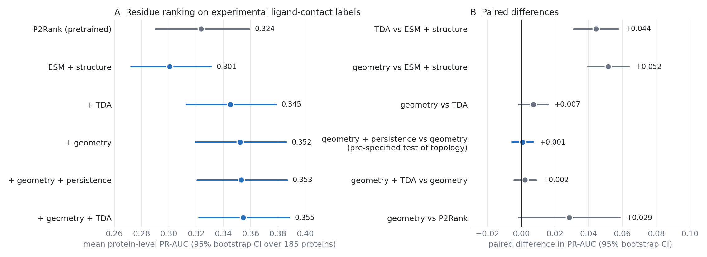

# Does Persistent Homology Help Predict Cryptic Binding Pockets? A Controlled Evaluation Against Geometric Baselines and P2Rank

## Abstract

Persistent homology (topological data analysis, TDA) has been proposed as a way to describe local protein structure for binding-site prediction. We asked whether TDA features improve residue-level prediction of cryptic ligand-binding sites from apo structures once a strong non-topological baseline is available. On CryptoBench (942 apo chains), a residue-graph model combining ESM2-35M embeddings, residue identity and backbone angles improved substantially when 34 TDA features were added: on a 185-protein holdout scored against experimentally derived ligand-contact residues, mean protein-level PR-AUC rose from 0.301 to 0.345 (paired p < 10^-9). However, 17 conventional per-residue geometry features (neighbor counts at six radii, relative solvent accessibility, half-sphere exposure, local shape ratios, ray-cast buriedness, convex-hull depth and residue depth) produced an equal or larger gain (PR-AUC 0.352). Adding persistence features to geometry changed PR-AUC by +0.0008 (95% bootstrap CI −0.005 to +0.007; paired p = 0.79), and the same null held on the official CryptoBench split with eight seeds. Geometry alone outperformed TDA alone on the official test split (PR-AUC 0.283 vs 0.261, 8 of 8 seeds). The geometry-based models also outperformed a pretrained P2Rank baseline in ROC-AUC (0.796 vs 0.756, paired p < 10^-3) and, by a rank test, in PR-AUC. We further show that a previously reported association between pocket size and PR-AUC (partial Spearman 0.756) is inflated by PR-AUC's dependence on class prevalence; after controlling for each protein's chance level the association is 0.30 to 0.37. We conclude that, on this benchmark, the predictive value attributed to persistent homology is fully accounted for by ordinary burial and shape descriptors, and that residue-level structural geometry is the main source of improvement over sequence embeddings alone.

## 1. Introduction

Cryptic pockets are ligand-binding sites that are absent or closed in the apo structure and open on binding or through conformational change. They matter for drug discovery because they make otherwise undruggable proteins tractable, but they are hard to predict because the apo structure does not display the cavity. Established pocket detectors such as Fpocket and P2Rank score geometric and physicochemical features of the observed structure; PocketMiner predicts cryptic-pocket formation from single structures with a graph neural network; protein language models such as ESM-2 supply sequence-derived features that require no alignment.

Persistent homology summarizes the multiscale connectivity of point clouds and has been used to featurize protein structure, including for binding-site and function prediction. Cavities and tunnels correspond naturally to H1 and H2 homology classes, which motivates using them for pocket prediction. The open question this paper addresses is narrower than "does TDA carry signal": *does it carry signal that ordinary geometric descriptors do not?* A gain over a weak baseline (sequence embeddings, residue identity, backbone angles) demonstrates only that structural information helps. It becomes evidence for topology only if it survives a baseline containing the descriptors a structural biologist would compute without TDA.

We test this directly. Our contributions are (i) a controlled comparison of TDA against a 17-feature plain-geometry set under an identical architecture, on two evaluation protocols; (ii) a comparison with a pretrained P2Rank baseline on the same residues; (iii) a correction to a commonly reported pocket-size effect that ignores the chance level of PR-AUC; and (iv) an account of what a probability-sharpened localization procedure does and does not achieve relative to P2Rank.

## 2. Methods

### 2.1 Data and evaluation protocols

We used CryptoBench: 942 apo protein chains passed our structure-retrieval and labeling filters (official split: 700 train, 60 validation, 182 test). Two evaluation protocols are used, and results are always labeled with the protocol that produced them.

* **Official-split protocol.** Train/validation/test as provided by the benchmark, with the benchmark's own residue labels. Eight seeds per arm. Model selection uses validation PR-AUC only.
* **Hard-split, experimental-site protocol.** To test generalization across protein types, chains were clustered without labels (k-means, k = 30, on L2-normalized graph-mean ESM2 embeddings; random state 166) and whole clusters were assigned to train (668 chains), validation (89) or test (185). The 185 test chains are the "185-protein holdout". This is an embedding-cluster holdout; it is *not* a verified sequence-family or fold-level split, and some remote homologs may cross it. Test residues are labeled from experimentally characterized ligand-binding structures: residues with a heavy atom within a fixed contact cutoff of the ligand, mapped onto the apo chain. Eight seeds per arm; per-residue test probabilities were exported and analyzed per protein, averaging over seeds within protein before pairing across arms (185 paired units per comparison).

### 2.2 Model

Each chain is a residue graph (Cα radius graph, cutoff 8 Å, at most 32 neighbors) processed by a four-layer E(n)-equivariant graph network (hidden width 128) with a per-residue classification head and an auxiliary pocket-center head. Node inputs are one-hot residue type, sine/cosine backbone dihedrals, and ESM2-35M embeddings (480-d), always present ("ESM + structure"). A separate side channel of per-residue features enters through a gated fusion module at every layer. **Every arm uses an identical 51-wide side channel** (34 TDA plus 17 geometry columns), with the columns not belonging to the arm set to zero, so architecture and parameter count are identical across arms. Loss is focal (alpha 0.9, gamma 2) plus a Huber term on the pocket center; AdamW, learning rate 10^-3, 40 epochs maximum, patience 8, batch 16.

### 2.3 Feature blocks

* **TDA (34).** For each residue, all heavy atoms within 12 Å; alpha-complex persistence (GUDHI) in dimensions 0, 1, 2; per-dimension summaries (number of bars, total, maximum, mean and standard deviation of persistence, persistence entropy, mean birth and death, and Betti numbers at radii 2, 3 and 5 Å), plus neighborhood atom count and radius of gyration. The **persistence-only** subset (23 features) excludes the Betti counts and the two burial-like features.
* **Geometry (17), the control.** Heavy-atom counts within 4, 6, 8, 10, 12 and 15 Å of Cα; relative solvent-accessible surface area (Shrake–Rupley, 200 points, normalized by theoretical maximum residue area); half-sphere exposure up and down (Cα-based, 13 Å); linearity, planarity and sphericity of the 12 Å heavy-atom cloud; offset of the Cα from that cloud's centroid; fraction of 100 rays from the Cα blocked by atoms within 10 Å and within 20 Å (rays expressed in a canonical local frame so the feature is rotation-invariant); depth below the convex hull of the chain; and residue depth (mean distance to the three nearest solvent-exposed atoms). Features are computed on the same chain, heavy atoms and residue filter as the TDA block (selenomethionine kept), verified to align with every graph node (942 of 942 chains; residue count and centered Cα coordinates matching to 10^-3 Å). All are rigid-motion invariant except Shrake–Rupley sampling noise in two features (measured at 2–3% of the feature mean).
* **ANM-MSF (1).** Predicted mean-square fluctuation from an anisotropic network model; excluded from the control arms because it added nothing in earlier tests (Section 3.7).

### 2.4 Arms and pre-specified comparison

Arms: ESM + structure; + TDA; + geometry; + persistence only; + geometry + TDA; + geometry + persistence. Before any result was seen, the primary question was fixed as **geometry + persistence versus geometry alone**: does topology proper add to geometry? Secondary comparisons are listed in the tables. Both a paired t-test and a Wilcoxon signed-rank test are reported; an effect is called confirmed only if both fall below 0.05. Eight to ten paired comparisons were examined per protocol; the one result we rely on as positive (geometry beats ESM + structure) survives Bonferroni correction by orders of magnitude, while the null on the primary comparison is unaffected by correction.

### 2.5 Metrics

Protein-level PR-AUC and ROC-AUC (per protein, then averaged); global residue-pooled PR-AUC and ROC-AUC on the official split. Because PR-AUC's chance level equals the positive fraction, we also report each protein's PR-AUC relative to its own exact chance level (mean average precision over 500 random score permutations of that protein's labels) as a difference, ratio ("lift") or normalized score. No thresholded metric is used in the main comparisons. 95% confidence intervals are bootstrap intervals over proteins (10,000 resamples).

### 2.6 P2Rank baseline

P2Rank 2.5.1 with its default pretrained model was run on the 185 apo structures; its per-residue score was evaluated on the identical residues (all 55,111 matched). P2Rank was pretrained on holo-style benchmark data, and overlap of some test proteins with its training data cannot be excluded; such overlap would favor P2Rank.

### 2.7 Localization

Pocket centers were estimated as probability-weighted centroids of residue coordinates, with probabilities raised to the tenth power before normalization ("sharpening"; no retraining). Distance to the experimental pocket center is reported (DCC at 4, 6, 8, 10 Å). P2Rank pockets were restricted to pockets with at least half their residues on the target chain; top-1 and best-of-3 are reported.

## 3. Results

### 3.1 TDA improves on ESM + structure

On the hard-split holdout, adding the 34 TDA features raised protein-level PR-AUC from 0.301 to 0.345 and ROC-AUC from 0.755 to 0.790 (Table 1; paired t-test p = 4×10^-10 and 9×10^-8, Wilcoxon p < 3×10^-10; better on 70% of proteins). This reproduces the gain that motivated the study.

### 3.2 Plain geometry gives an equal or larger gain

The 17 geometry features gave PR-AUC 0.352 (+0.052 over ESM + structure, 95% CI +0.039 to +0.064; p < 10^-13; better on 79% of proteins). Geometry alone was numerically ahead of TDA alone (+0.007, CI −0.002 to +0.016; t p = 0.11, Wilcoxon p = 0.069) (Figure 1).

**Table 1. Hard-split holdout, 185 proteins, experimental ligand-contact labels (means over proteins; 8 seeds averaged per protein).**

| Method | PR-AUC | Lift over chance | ROC-AUC | Median ROC-AUC |
|---|---|---|---|---|
| P2Rank (pretrained) | 0.324 | 3.87 | 0.756 | 0.786 |
| ESM + structure | 0.301 | 3.46 | 0.755 | 0.837 |
| + TDA | 0.345 | 3.99 | 0.790 | 0.857 |
| + geometry | 0.352 | 4.17 | 0.796 | 0.853 |
| + geometry + persistence | 0.353 | 4.12 | 0.797 | 0.855 |
| + geometry + TDA | 0.355 | 4.11 | 0.799 | 0.866 |

### 3.3 Topology adds nothing detectable to geometry (primary result)

Adding persistence features to geometry changed protein-level PR-AUC by +0.0008 (95% bootstrap CI −0.0052 to +0.0070; t p = 0.79, Wilcoxon p = 0.89; better on 50% of proteins) and ROC-AUC by +0.0008 (p = 0.79/0.86). Adding all TDA features to geometry gave +0.0023 (CI −0.0043 to +0.0089; p = 0.50/0.32). The interval bounds the plausible benefit of topology beyond geometry at roughly +0.007 PR-AUC, an order of magnitude smaller than the gain both feature families give over ESM + structure. The converse is not symmetric: adding geometry to TDA improved PR-AUC by +0.0095 (p = 0.001), i.e. TDA does not subsume geometry.

### 3.4 The same result on the official split

Under the official protocol (700/60/182 chains, benchmark labels, eight seeds; Table 2), the primary comparison was again null: geometry + persistence versus geometry, validation PR-AUC −0.011 (t p = 0.070, Wilcoxon p = 0.109; 2 of 8 seeds better), test PR-AUC +0.003 (p = 0.42/0.46), test ROC-AUC +0.002 (p = 0.16/0.25). Geometry alone beat TDA alone on test PR-AUC (0.283 vs 0.261; 8 of 8 seeds; t p = 5×10^-4, Wilcoxon p = 0.008) and ROC-AUC (0.852 vs 0.847; p = 0.010/0.016).

**Table 2. Official CryptoBench split, mean over 8 seeds.**

| Arm | Validation PR-AUC | Test PR-AUC | Test ROC-AUC |
|---|---|---|---|
| ESM + structure | 0.224 | 0.238 | 0.816 |
| + geometry | 0.311 | 0.283 | 0.852 |
| + TDA | 0.299 | 0.261 | 0.847 |
| + persistence only | 0.293 | 0.264 | 0.847 |
| + geometry + TDA | 0.300 | 0.283 | 0.853 |
| + geometry + persistence | 0.300 | 0.286 | 0.854 |

A retraining of the same six arms on the hard split, evaluated globally over pooled test residues, agreed in ordering (test PR-AUC: geometry 0.265, geometry + persistence 0.261, geometry + TDA 0.261, TDA 0.254, ESM + structure 0.227).

### 3.5 Most of the TDA gain is already present in two burial features

An earlier component ablation (official split, eight seeds) used only the two burial-like features inside the TDA block (atoms within 12 Å; gyration). Test PR-AUC was 0.266 for burial alone versus 0.268 for the full persistence block (p = 0.74) and 0.268 for all TDA. The persistence block did beat burial on test ROC-AUC (+0.0105; 8 of 8 seeds; p = 0.007), a small gain that the richer geometry set then absorbed (Section 3.4).

### 3.6 Comparison with P2Rank

The geometry-based models outperformed P2Rank on the same residues in ROC-AUC (0.796 vs 0.756; +0.041; t p = 1.2×10^-4, Wilcoxon p = 2.5×10^-6; better on 66% of proteins) and in PR-AUC by the rank test (0.352 vs 0.324; +0.029; Wilcoxon p = 0.008) but not by the t-test (p = 0.062; bootstrap CI −0.001 to +0.058). ESM + structure alone did not outperform P2Rank (PR-AUC 0.301 vs 0.324, t p = 0.13, Wilcoxon p = 0.30; ROC-AUC 0.755 vs 0.756). The advantage over a standard tool is therefore modest and comes from structural geometry, not from topology or the language-model embedding alone.

### 3.7 ANM-derived flexibility does not help

Adding a single-feature ANM mean-square-fluctuation channel gave no change in validation PR-AUC (0.3539 vs 0.3539 across eight seeds; p = 0.995). Adding the variability of the 34 TDA features across eight ANM-perturbed conformations reduced validation PR-AUC (−0.0105; p = 0.016; 7 of 8 seeds). We treat the first as a null and the second as a negative result; the raw fluctuation values were extremely heavy-tailed and a rank-based normalization was not tried.

### 3.8 Pocket size and prediction difficulty, corrected for chance level

Performance is strongly associated with the number of experimentally labeled pocket residues (partial Spearman with protein-level PR-AUC controlling for protein size: 0.719 for geometry, 0.752 for TDA, 0.718 for ESM + structure). But PR-AUC's chance level equals the positive fraction, so larger pockets raise PR-AUC even for a random scorer; P2Rank shows a similar PR-AUC association (0.565). Two prevalence-free views are much weaker: with protein-level ROC-AUC the partial correlations are 0.37 (geometry), 0.44 (TDA), 0.35 (ESM + structure) and 0.15 (P2Rank), and after also controlling for each protein's exact chance PR-AUC they are 0.30 (geometry), 0.35 (TDA), 0.37 (ESM + structure) and 0.20 (P2Rank). Small pockets are harder, but roughly half of the association reported when only protein size is controlled reflects the metric, and the earlier value of 0.756 should not be read as a measure of difficulty. Because pocket size and chance PR-AUC are themselves strongly correlated, controlling for the latter may over-correct; the true effect lies between 0.30 and 0.75 in these units.

### 3.9 Localization

Probability sharpening (exponent 10) reduced mean pocket-center error from 11.77 to 10.16 Å (ESM + structure), 11.67 to 10.07 Å (TDA) and 11.74 to 10.05 Å (TDA + ANM), without retraining. The highest-probability residues were enriched around the experimental center (about 6.4-fold within 4 Å and 10.7-fold within 6 Å among the top 1%). On the 181 of 185 chains where P2Rank returned a pocket on the target chain, P2Rank's top pocket had mean error 13.55 Å (DCC4 13.8%); allowing three pockets, 9.06 Å (DCC4 18.8%, DCC6 39.8%). On the same chains the model's sharpened centers had mean error 10.1–10.2 Å (DCC4 13–16%, DCC6 32–34%, DCC8 49–53%, DCC10 65–66%, depending on arm). Thus the model localizes better than P2Rank's top-ranked pocket at loose thresholds but is not better than P2Rank when P2Rank is allowed three guesses at tight thresholds. Localization was evaluated for the original TDA and ANM arms; it was not repeated for the geometry arms.

## 4. Discussion

**What the evidence supports.** Adding structural descriptors to a sequence-embedding baseline substantially improves residue-level cryptic-pocket prediction, and TDA features are one way to supply such descriptors. A 17-feature set of ordinary geometry supplies them at least as well, on two evaluation protocols with independently trained models, and topology adds nothing that survives on top of it. The measured interval for the added benefit of persistence features (about −0.005 to +0.007 PR-AUC on 185 proteins) excludes any gain comparable to the 0.04–0.05 attributed to TDA against the weaker baseline.

**Why the original comparison misled.** The initial baseline contained residue identity and backbone dihedral angles but no burial, exposure or local-shape information; the TDA block contained two burial-like summaries, so it partially supplied what the baseline lacked. Persistence features are also strongly correlated with local density and shape. The apparent benefit of topology was a benefit of *any* local-geometry information.

**What we do not claim.** We do not claim that topology carries no information about pockets in any setting, only that it added none beyond a strong geometric baseline in this model, benchmark and TDA recipe. A different representation (persistence images, learned filtrations, ligand-aware or multi-atom-type filtrations, or larger neighborhoods) might behave differently. A null result is also not proof of equivalence: the intervals above bound, rather than exclude, a small effect.

**Practical implication.** For cryptic-pocket prediction from apo structure, cheap geometric descriptors deserve to be the default baseline, and claims for more elaborate structural encodings should be judged against them.

## 5. Limitations

1. The hard split is a label-free embedding-cluster holdout, not a verified family-level split; remote homologs may cross it.
2. The geometry set was designed by us (17 features). A weaker or differently designed control could give a different verdict; a stronger one would only strengthen it.
3. Two protocols and one benchmark (CryptoBench); results were not tested on an independent temporal or external cryptic-pocket set.
4. The comparison with P2Rank uses its default model and may be affected by training overlap that favors P2Rank; localization is compared with P2Rank only for the original arms.
5. Protein-level intervals are bootstrap intervals over proteins and treat the seed-averaged prediction for each protein as fixed; seed-to-seed variance is addressed separately by the eight-seed paired tests on the official split.
6. The geometry control has been run on CryptoBench (this paper) and on the project's main pipeline (a 2,055-chain pool, 10-fold cross-validation, ESM2-35M). On the main pipeline the picture differs slightly: geometry alone beat topology alone (test PR-AUC +0.0129, 10/10 folds), but topology added a small residual on top of geometry (+0.0097 PR-AUC, 95% CI +0.0022 to +0.0171, 9/10 folds, paired t p = 0.017, Wilcoxon p = 0.037; ROC-AUC +0.0015, p = 0.25/0.16, not significant). The conclusion "topology adds nothing" is therefore specific to CryptoBench; on the larger main-pipeline pool a small residual effect remains that we cannot attribute to any topological property. The control was not repeated at the 650M/3B embedding scales, for COACH420/HOLO4K benchmark scoring, or for localization.
7. Localization used a fixed sharpening exponent chosen on the evaluated set.

## 6. Conclusion

Persistent-homology features improved cryptic-pocket residue prediction over a sequence-embedding and residue-identity baseline, but the improvement was fully reproduced by 17 conventional geometry features and topology added no detectable benefit to them (PR-AUC difference +0.0008; bootstrap interval −0.005 to +0.007). Geometry-based models modestly outperformed a pretrained P2Rank baseline in residue ranking. A reported dependence of performance on pocket size is substantially inflated by class prevalence. These results make burial and local shape, not topology, the supported explanation for the gains, and they establish a control that future topology-based pocket predictors should be measured against.

## Figures

**Figure 1.** (A) Mean protein-level PR-AUC on the 185-protein holdout with 95% bootstrap intervals over proteins. (B) Paired differences with 95% bootstrap intervals; the highlighted row is the pre-specified test of whether topology adds to geometry.

## Reproducibility

Code and per-phase generators: Phases 227 (geometry features), 228 (official-split control), 232 (hard-split control with exported probabilities), 233 (protein-level statistics), 225 (prevalence-normalized pocket-size analysis), 226 (P2Rank baseline), 234 (figure). Geometry code: `cryptic-pocket/phase227_geometry.py`. Structures were re-fetched from the RCSB and checked against the stored graph coordinates.
