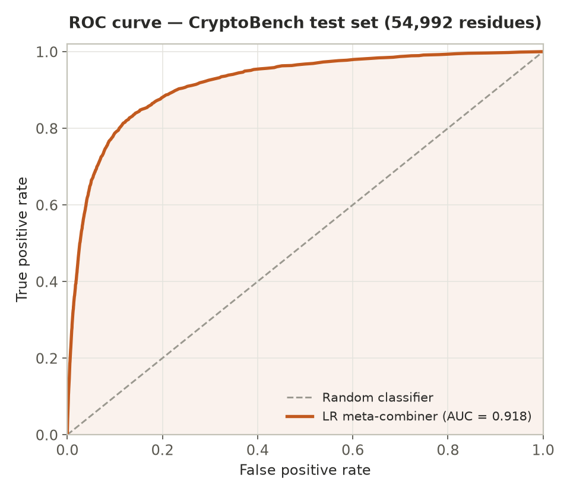
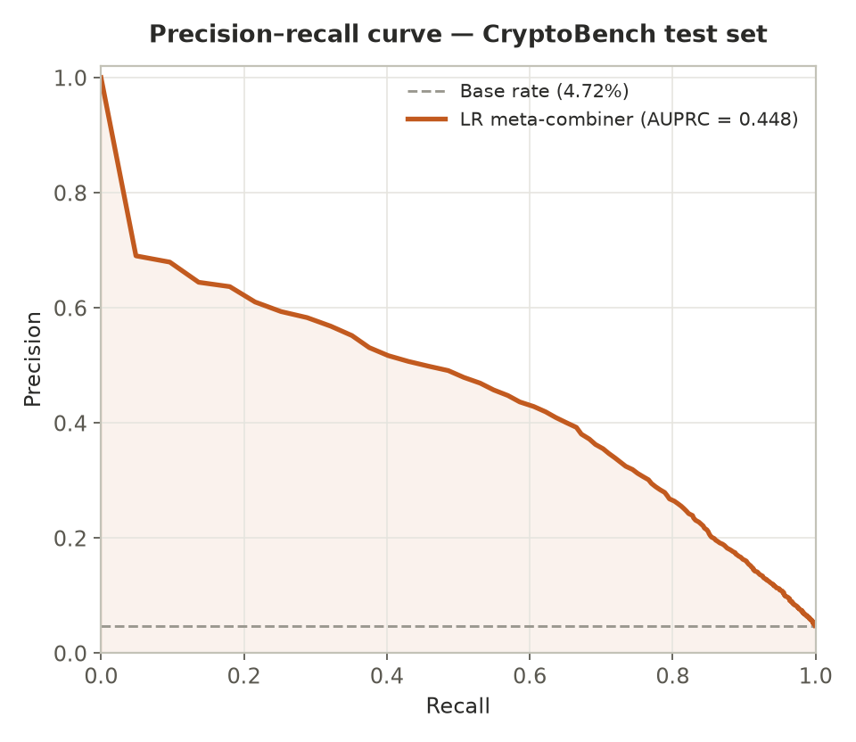
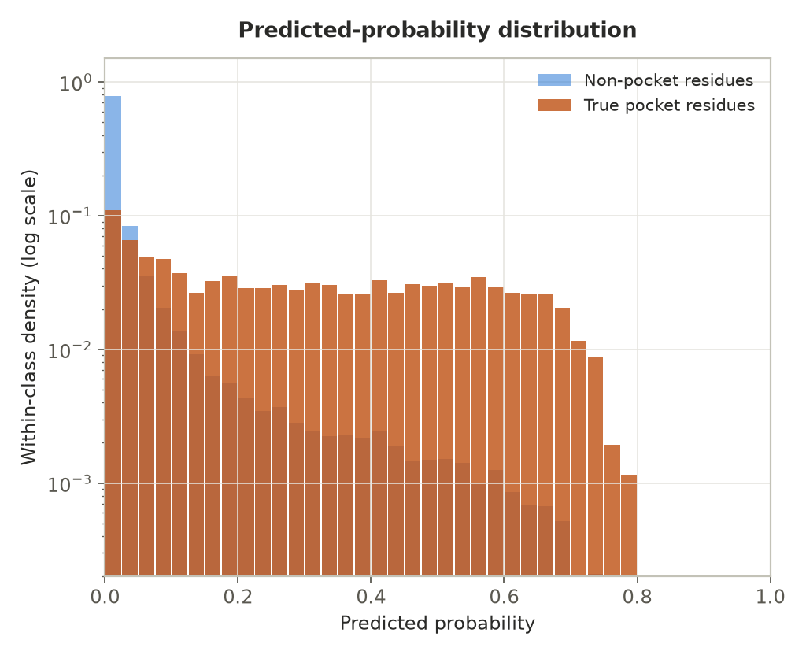
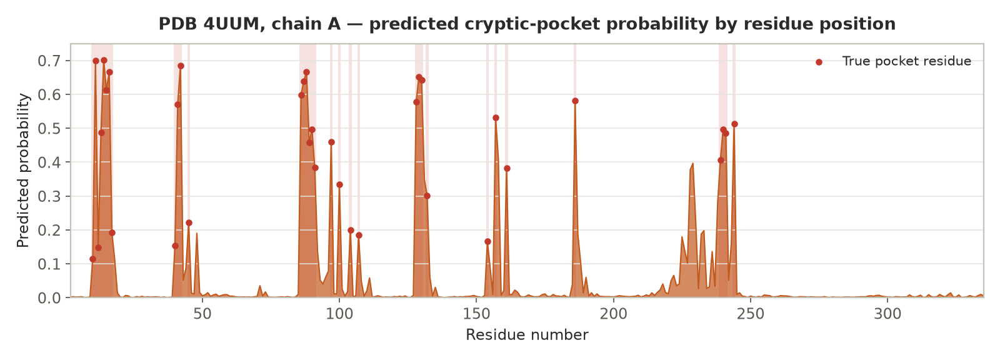
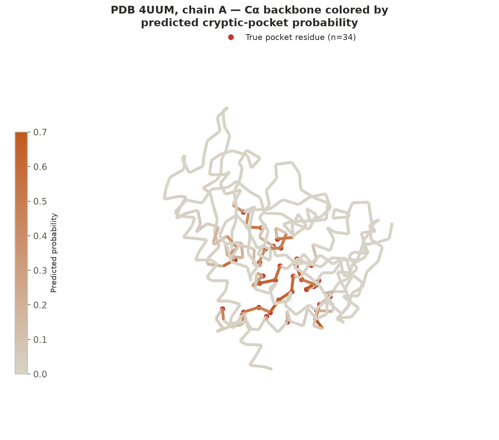

# Model Prediction Visuals

These are five pictures showing what the model actually predicts, using real test data
it had never seen during training. The model looks at a protein and guesses which parts
of it might form a "cryptic pocket", a spot where a drug molecule could bind, that isn't
visible just by looking at the protein's normal resting shape.

The pictures are in this same folder.

---

## 1. ROC curve

**The idea:** the model gives every part of the protein a score from 0 to 1, how likely
it thinks that spot is a pocket. To turn scores into a yes/no answer, you need to pick a
cutoff (like "anything above 0.5 counts as a pocket"). This picture shows what happens as
you slide that cutoff up and down: how often the model catches a real pocket (going up)
versus how often it wrongly flags a normal spot as a pocket (going sideways). A model that
was just guessing randomly would draw a straight diagonal line. A perfect model would shoot
straight up the left side and across the top.

**What it shows here:** the curve shoots up fast and stays high, the model catches most
real pockets while making very few wrong guesses. The single number that sums up this whole
picture is 0.918 out of 1.0 (0.5 would mean random guessing), which is a strong score.

## 2. Precision–recall curve

**The idea:** only about 1 in 20 spots on a protein is actually a real pocket, most of
the protein is not a pocket. Because of that, it's easy for a model to look "accurate" just
by saying "no" almost all the time. This picture is a fairer test for exactly that
situation: it asks, "when the model DOES say yes, how often is it actually right?" (that's
precision) and "of all the real pockets out there, how many did the model actually find?"
(that's recall). The dashed line shows what a random guess would look like, since only
1 in 20 spots is real, a random guesser would be right only about 5% of the time.

**What it shows here:** the model does much better than random, especially at the start
of the curve, when the model is most confident, it's right about 7 times out of 10. That's
a big improvement over the 1-in-20 random baseline.

## 3. Predicted-probability distribution

**The idea:** this chart splits every spot on every test protein into two groups, spots
that are really pockets (orange) and spots that aren't (blue), and shows what score the
model gave each group. If the model were good at telling them apart, the two colors should
look different from each other.

**What it shows here:** the blue bars (non-pockets) are almost all piled up near a score
of 0, the model is confidently saying "not a pocket" for most of the protein, and it's
right. The orange bars (real pockets) are spread out much more, reaching up toward 0.7–0.8.
The two groups clearly look different, which is exactly what you want to see, it means the
model has genuinely learned to tell the two apart, not just guessing.

## 4. A real prediction, laid out along the protein chain

**What this is:** one actual protein from the test set, called **4UUM** (just its ID
in a public database), 334 building blocks long (each "building block" is called a
residue). Out of those 334, 34 are real pocket spots, marked here with red dots. The
orange fill shows the score the model gave each spot as you move along the chain.

**Why this is the best proof the model works:** almost every orange peak lines up with
a red dot. And almost everywhere there's no red dot, the model's score is flat and low.
That's a hard thing to get right, the shape of this protein shown here doesn't have any
visible pocket at all; it only opens up once a drug binds to it. The model has to guess,
from clues in the shape and sequence, which spots are *likely to become* a pocket, without
ever seeing the pocket itself. It's not flawless, there's one orange peak around the
middle where nothing was really there, and a couple of real pocket spots earlier on got
only a so-so score, but showing those mistakes honestly is part of the point.

## 5. The same real prediction, shown on the actual 3D shape

**What this is:** the same protein, but now drawn as its actual folded 3D shape instead
of a flat line. The backbone is colored from pale grey (low score) to orange (high score),
and the real pocket spots are marked with red beads.

**What it shows:** the orange-colored parts of the backbone are bunched together in one
area of the folded protein, not scattered randomly all over, which is exactly what a real
pocket should look like, since a pocket is one connected pit or cavity, not disconnected
dots. The red beads (the real answer) sit right on top of the orange (the model's guess),
which is the 3D version of the same good result shown in the chart above.

---

### How these were made

The first three charts use the model's scores on every test protein at once (182 proteins,
about 55,000 building blocks total). The last two charts zoom into one specific protein,
4UUM, picked because the model did especially well on it (it correctly told pockets from
non-pockets almost perfectly for this one protein) and because it has several separate
pocket regions rather than just one, making for a clearer example. The 3D shape file was
downloaded from a public protein database and carefully matched up, block-by-block, with
the model's predictions to make sure each score lined up with the correct spot before
drawing anything.
